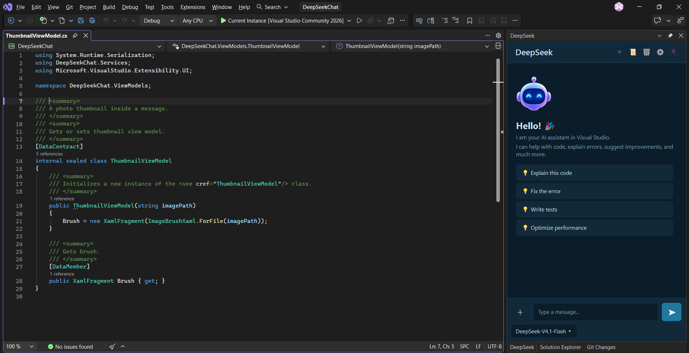
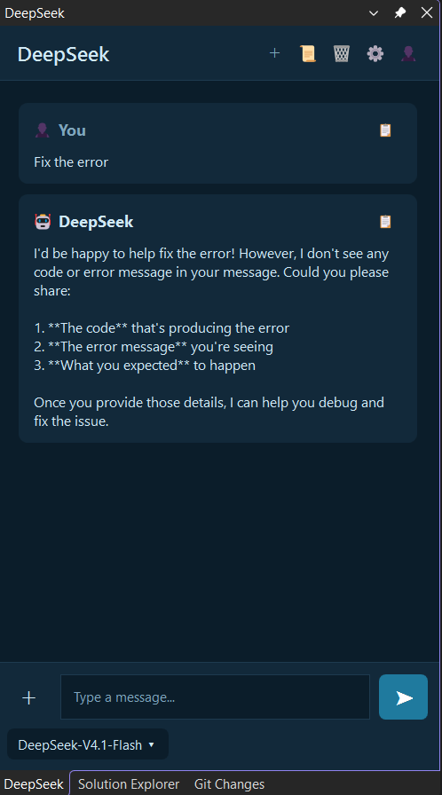
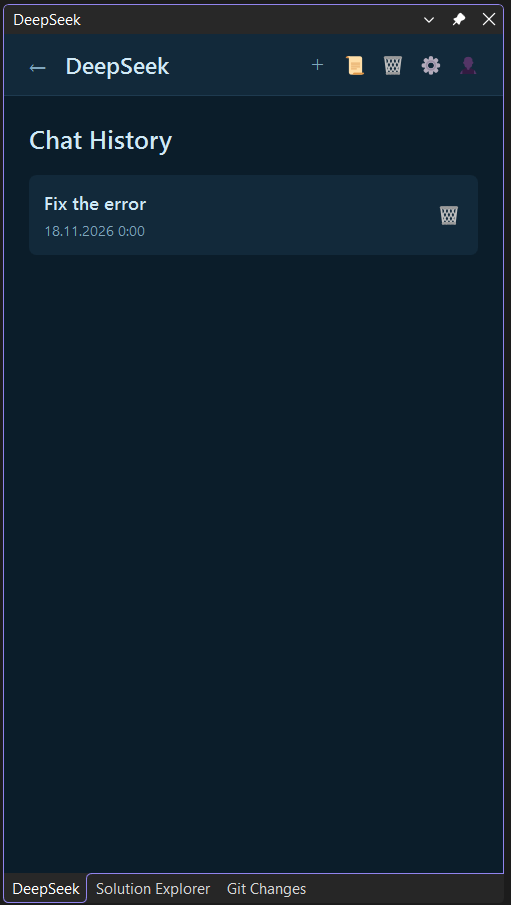
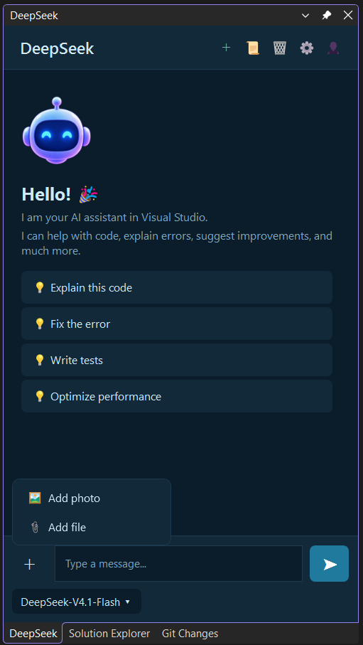
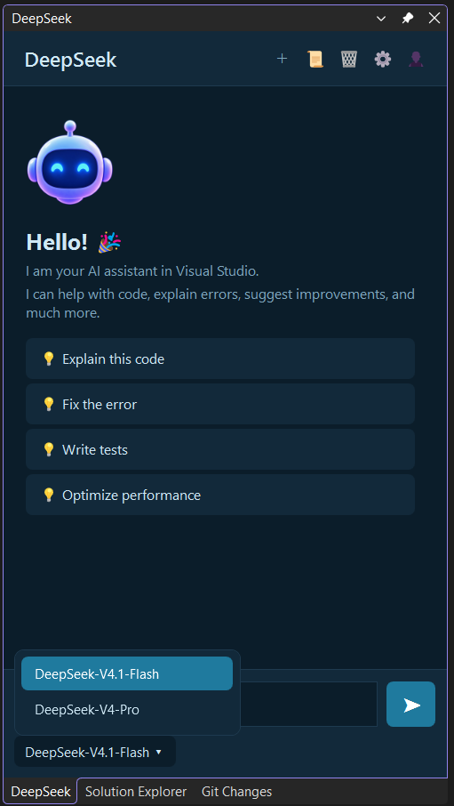
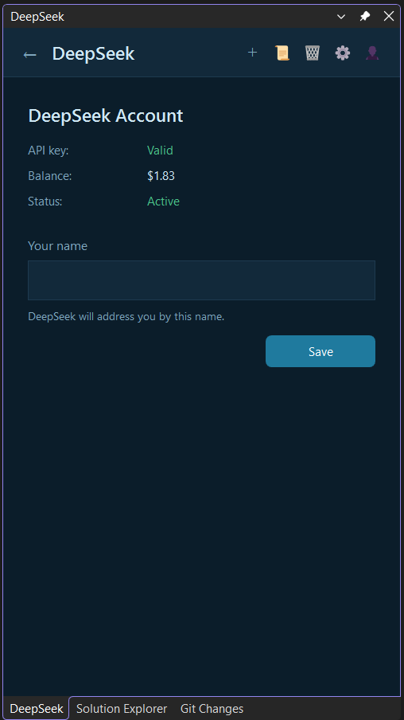
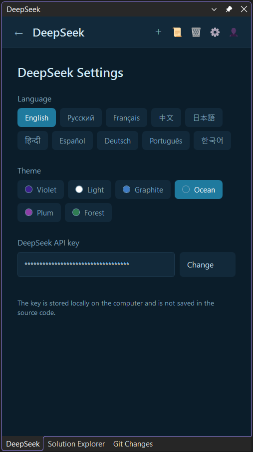

# DeepSeek AI Assistant for Visual Studio

[](https://github.com/Krivoukhova/DeepSeekChat_VS/actions/workflows/build.yml)
[](LICENSE)

A DeepSeek-powered chat tool window for Visual Studio. The extension uses the
out-of-process `VisualStudio.Extensibility` model and provides editor commands
for explaining and refactoring selected code.

> **Project status:** Community-maintained, open-source software. This project is
> not affiliated with, endorsed by, or supported by DeepSeek or Microsoft.

<p align="center">
  
</p>

## Features

- Chat tool window available from **View → Other Windows → DeepSeek AI Assistant**.
- **Explain with DeepSeek** and **Refactor with DeepSeek** editor commands for selected code.
- File and image attachments.
- Model selection, chat history with conversation context sent to the model, account balance/key status, and configurable display name.
- Multiple interface languages and themes.

## Screenshots

| Chat | Chat history |
| --- | --- |
|  |  |

| Attachments | Model selection |
| --- | --- |
|  |  |

| Account | Settings |
| --- | --- |
|  |  |

The available models and capabilities are defined in `DeepSeekChat/Models/ChatModels.cs`.
Availability is subject to the DeepSeek API account, model access, and upstream API changes.

## Requirements

- Windows.
- Visual Studio 2022 17.14 or later, or Visual Studio 2026.
- A DeepSeek API key for live requests.

To build from source you also need the **Visual Studio extension development**
workload and the .NET 8 SDK.

The extension targets `net8.0-windows8.0` and references the 17.14
`Microsoft.VisualStudio.Extensibility` SDK packages. It runs out of process in the
.NET runtime supplied by Visual Studio itself (.NET 8 in Visual Studio 2022, .NET 10 in
Visual Studio 2026), so no separate runtime needs to be installed. Both runtimes are
declared in the extension metadata (`DotnetTargetVersions`). When the extension runs
from a Debug build, Visual Studio shows a flask icon next to it; Release builds do not.

## Install

### From Visual Studio Marketplace

Open **Extensions → Manage Extensions**, search for **DeepSeek AI Assistant**,
and click **Install**. Restart is not required for this out-of-process extension,
but Visual Studio may ask to close for the installer.

### From a VSIX package

1. Download the release `.vsix` asset from the repository's **Releases** page.
2. Close Visual Studio if the installer requests it.
3. Open the `.vsix` file and follow the Visual Studio Installer prompts.
4. Start Visual Studio and open **View → Other Windows → DeepSeek AI Assistant**.
5. Add your DeepSeek API key in the extension's account/settings interface.

### Build from source

```powershell
git clone https://github.com/Krivoukhova/DeepSeekChat_VS.git
cd DeepSeekChat_VS
dotnet restore .\DeepSeekChat\DeepSeekChat.csproj
dotnet build .\DeepSeekChat\DeepSeekChat.csproj --configuration Release
```

Open `DeepSeekChat.slnx` in Visual Studio to debug the extension with F5.
The SDK build generates the VSIX package under the project's Release output
directory. The exact output path can vary with the installed SDK and target
framework; locate `DeepSeekChat.vsix` under `DeepSeekChat/bin/Release/`.

## Configure

1. Obtain an API key from the official [DeepSeek platform](https://platform.deepseek.com/).
2. Open DeepSeek AI Assistant in Visual Studio.
3. Enter and save the API key in the account/settings UI.
4. Choose the model and preferences you want to use.

### Local data and privacy

The extension stores its user data under:

```text
%APPDATA%\DeepSeekChat\
```

The API key is stored in `apikey.dat`, encrypted with Windows DPAPI for the
current Windows user (a plain-text `settings.txt` from pre-release builds is
migrated and deleted automatically). Chat history is stored in `chats.json`, UI
preferences in `ui.json`, and cached copies of sent images in `images/`; chat
history and images are **not** encrypted. Deleting a chat also deletes its cached
images. Do not commit API keys, chat history, or personal attachments to source control.

Prompts, selected code, and attached content are sent to the DeepSeek API when
you submit a request. Do not submit secrets, credentials, personal data, or
proprietary source code unless you are authorized to share them with that service.
Review DeepSeek's current privacy terms and API documentation before use.

## Repository layout

| Path | Responsibility |
| --- | --- |
| `DeepSeekChat/Commands/` | Visual Studio commands and selected-code request orchestration |
| `DeepSeekChat/Constants/` | API and UI constants |
| `DeepSeekChat/Hosting/` | Extension entry point and dependency registration |
| `DeepSeekChat/Localization/` | Language definitions and translations |
| `DeepSeekChat/Models/` | API, chat, attachment, and preference models |
| `DeepSeekChat/Services/` | API client, persistence, attachments, and UI helpers |
| `DeepSeekChat/Theming/` | Theme definitions and palettes |
| `DeepSeekChat/UI/` | Tool window and Remote UI markup |
| `DeepSeekChat/ViewModels/` | Presentation state and commands |
| `DeepSeekChat/Images/` | Visual Studio command icons |
| `DeepSeekChat/Resources/` | Embedded extension resources |


## Documentation

Detailed guides are available in the [`docs/`](docs/README.md) directory:

- [Getting started](docs/getting-started.md)
- [Architecture](docs/architecture.md)
- [Development](docs/development.md)
- [Privacy and security](docs/privacy.md)
- [Publishing](docs/publishing.md)


## Development notes

- Keep API keys and user data out of commits and issue attachments.
- Preserve cancellation-token flow for asynchronous operations.
- Dispose HTTP and file resources deterministically.
- Keep user-facing strings in the localization resources.
- Prefer small, focused changes and add tests when introducing testable logic.
- Do not commit generated `bin/`, `obj/`, `.vs/`, or `.vsix` output.

## Contributing

Contributions are welcome. Please read [CONTRIBUTING.md](CONTRIBUTING.md)
before opening a pull request. For security-sensitive reports, see
[SECURITY.md](SECURITY.md).

## License

Distributed under the [MIT License](LICENSE).
