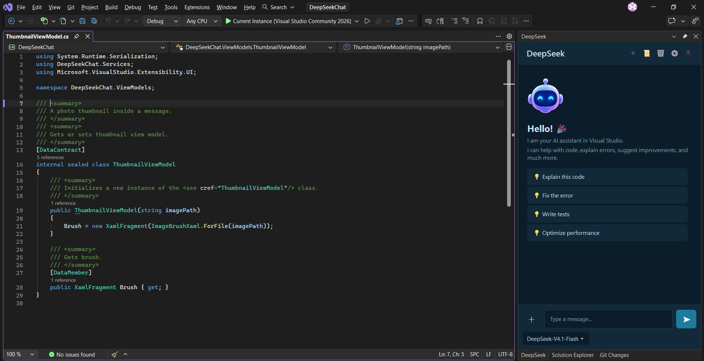
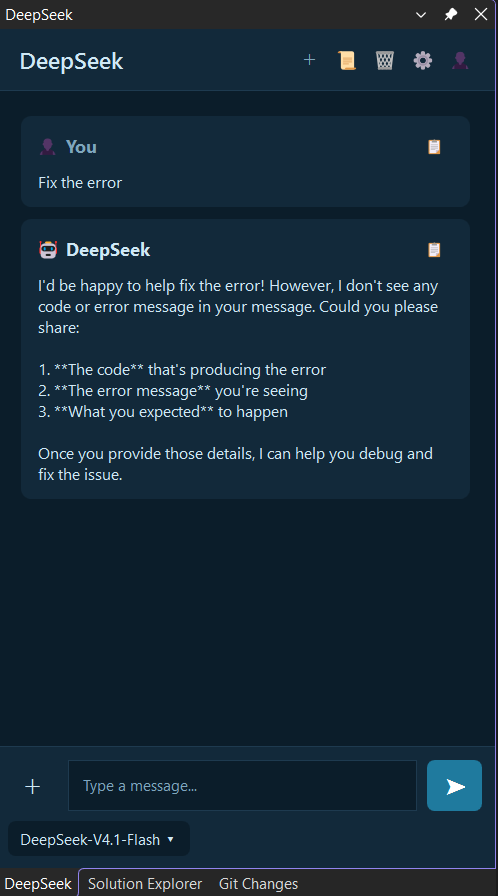
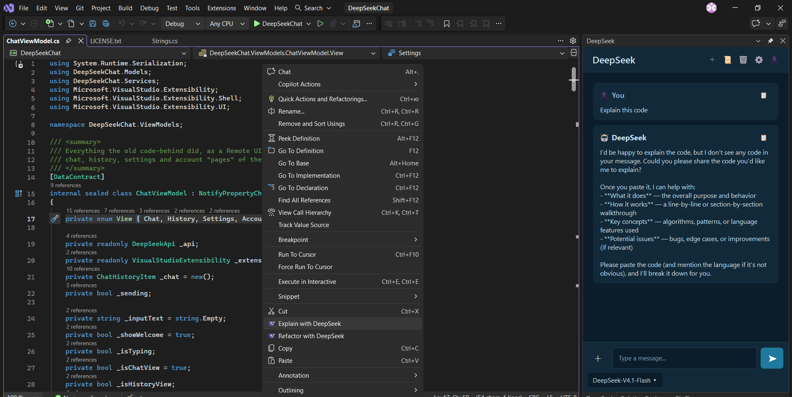
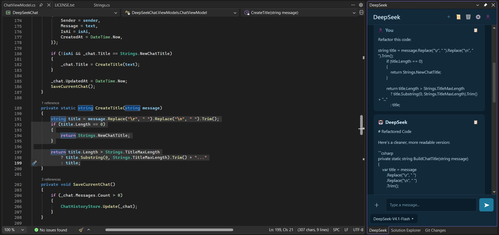
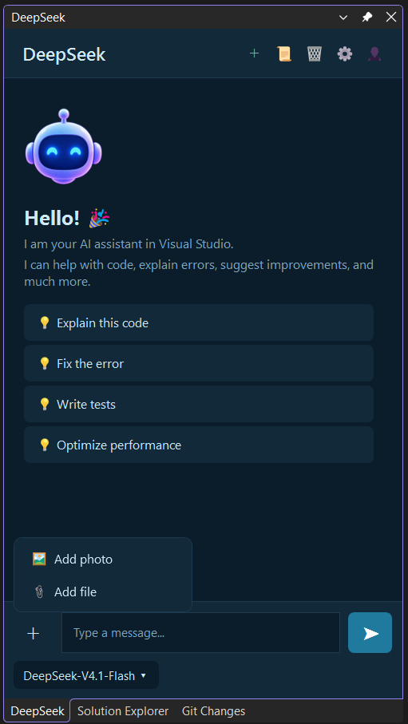
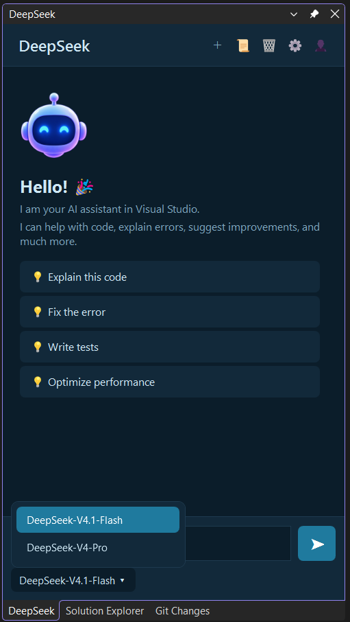
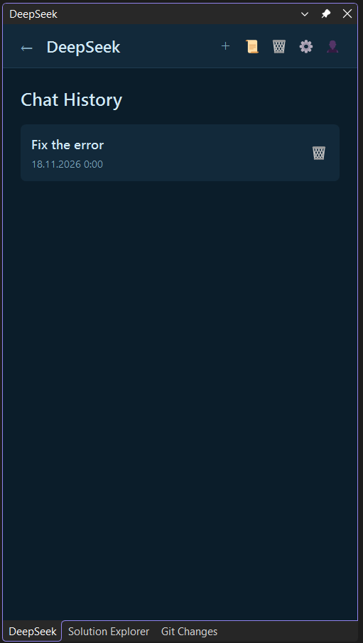
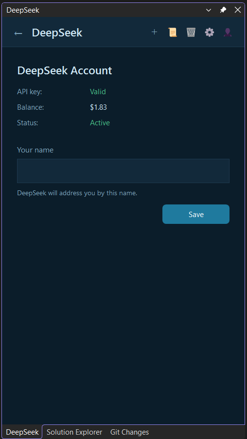
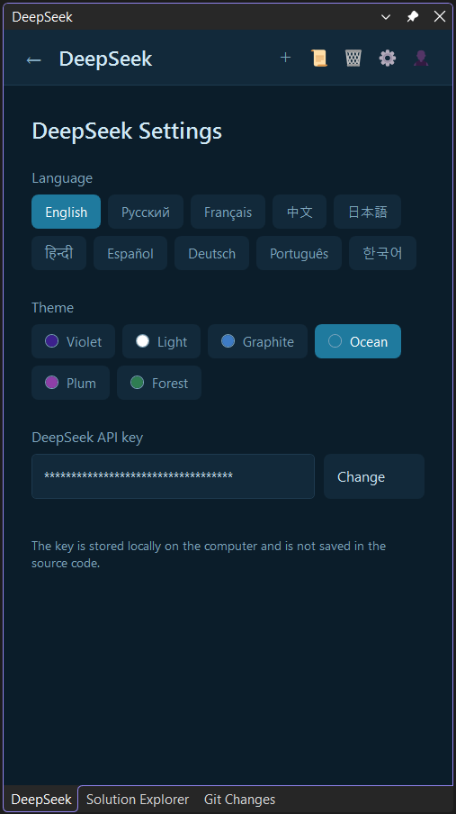

# DeepSeek AI Assistant

**AI coding assistant for Visual Studio 2022 and 2026**

  

## Features

- AI chat inside Visual Studio with conversation context
- Explain selected code
- Refactor selected code
- Quick Actions: explain, fix errors, write tests, optimize performance
- Image and file attachments
- Model selection
- Local chat history
- DeepSeek account information (key status and balance)
- API key stored encrypted for your Windows account
- 10 interface languages and several themes

## AI Chat

Chat with DeepSeek directly inside Visual Studio.

  

## Explain Code

Select code in the editor and use **Explain with DeepSeek** from the context menu.

  

The selected code is placed in the chat input; review it and send. DeepSeek's explanation appears in the chat.

## Refactor Code

Select code in the editor and use **Refactor with DeepSeek** from the context menu.

DeepSeek provides refactoring suggestions in the chat.

  

## Attachments

Attach text files and images to your message.

  

## Models

Choose the DeepSeek model for your requests.

  

## Quick Actions

Quick Actions fill the input with a ready request for common tasks:

- **Explain this code**
- **Fix the error**
- **Write tests**
- **Optimize performance**

## Chat History

Conversations are saved locally and can be reopened or deleted later.

  

## Account

View API key status, account balance and connection status.

  

## Settings

Configure your DeepSeek API key, language, theme and display name directly from Visual Studio.

  

## Getting Started

1. Install **DeepSeek AI Assistant**.
2. Open **View → Other Windows → DeepSeek AI Assistant**.
3. Open **Settings** and enter your DeepSeek API key.
4. Save the settings.
5. Start chatting with DeepSeek.

## Requirements

- Visual Studio 2022 (17.14 or later) or Visual Studio 2026
- A DeepSeek API key

## Documentation

For detailed documentation, visit the [GitHub repository](https://github.com/Krivoukhova/DeepSeekChat_VS).

## Privacy

- The API key is stored encrypted (Windows DPAPI) and is used only to authenticate requests to the DeepSeek API.
- Chat history and settings are stored locally on your computer. Chat history is not encrypted.
- **Your messages, selected code and attached files are sent to the DeepSeek API** when you submit a request. Do not send secrets or code you are not allowed to share. See [DeepSeek's privacy terms](https://platform.deepseek.com/).

## Project

GitHub: https://github.com/Krivoukhova/DeepSeekChat_VS
